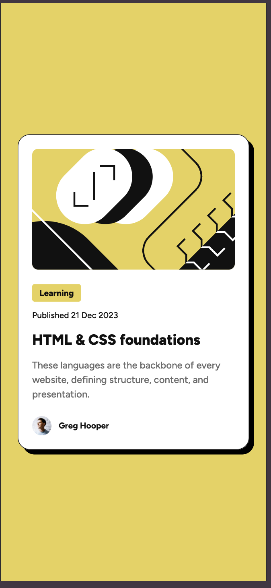

# Frontend Mentor - Blog preview card solution

This is a solution to the [Blog preview card challenge on Frontend Mentor](https://www.frontendmentor.io/challenges/blog-preview-card-ckPaj01IcS). Frontend Mentor challenges help you improve your coding skills by building realistic projects. 

## Table of contents

- [Overview](#overview)
  - [The challenge](#the-challenge)
  - [Screenshot](#screenshot)
  - [Links](#links)
- [My process](#my-process)
  - [Built with](#built-with)
  - [What I learned](#what-i-learned)
  - [Continued development](#continued-development)
  - [Useful resources](#useful-resources)
  - [AI Collaboration](#ai-collaboration)
- [Author](#author)
- [Acknowledgments](#acknowledgments)

## Overview

### The challenge

Users should be able to:

- See hover and focus states for all interactive elements on the page

### Screenshot

### Links

- Solution URL: [https://github.com/iApolloBear/Blog-Preview-Card](https://github.com/iApolloBear/Blog-Preview-Card)
- Live Site URL: [https://iapollobear.github.io/Blog-Preview-Card](https://iapollobear.github.io/Blog-Preview-Card)

## My process

### Built with

- Semantic HTML5 markup
- CSS custom properties
- Flexbox
- Mobile-first workflow

### What I learned

How to implement accessibility and improve my css styles structures.

### Continued development

- Good practices.
- Improve maintainability and accessibility.

### AI Collaboration

Asked ChatGPT about how to improve my maintainability, accessibility and implement semantic HTML.

## Author

- Frontend Mentor - [iApolloBear](https://www.frontendmentor.io/profile/iApolloBear)

